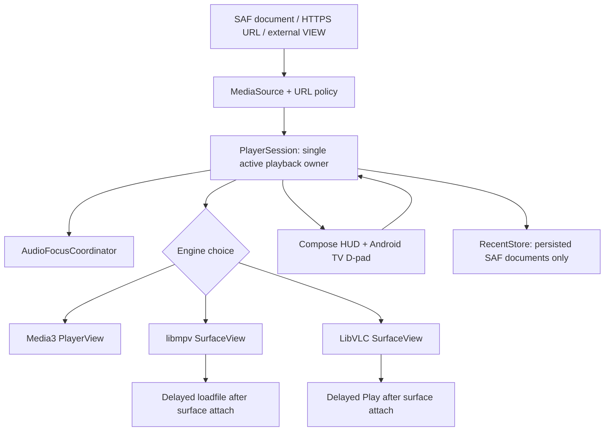

# Bousy Player v0.10 — Standalone architecture

## Ownership and playback intention

`PlayerSession` creates, switches and releases the sole foreground playback engine, never overlapping two native decoder instances. The current source, playlist, intent to Play/Pause, speed, aspect ratio, saved resume target and explicit/automatic engine selection live in the session. `PlayerScreen` uses `PlaybackSnapshot` for its UI; its lifecycle disposes the session on exit. A separate `AudioFocusCoordinator` owns focus and headset-noisy events across all engines.

A successful engine's latest position is read before replacement. If the constructor or load fails before producing a timeline, the last attempted resume offset is retained. Confirmed end-of-file saves completion and releases focus; manual Pause survives engine handoffs and delayed events. The authoritative resume gate separates "decoder has seen duration/early time" from "decoder acknowledged the saved seek" so a transient 0:00 cannot erase Continue Watching. User-initiated Start Over also waits for a real seek position before saving it. Relative D-pad seeks use the pending saved resume target until the actual decoder timeline acknowledges it; an EOF replay opens a fresh engine at 0:00. Fatal errors relinquish system audio focus.

## Native output ordering

`PlayerSession.open()` loads before Compose mounts the engine's view. Native players therefore need a surface-ready gate: VLC stores media and waits to start Play, while MPV stores a pending URL and waits to send `loadfile`. Both retain the selected SAF descriptor until native teardown. Re-attaching VLC cannot override an explicit Pause.

AUTO uses Media3 except for TS/M2TS/MTS, which prefer libmpv. An automatic native constructor/load failure may fall back to Media3. If libmpv instead fails **asynchronously before becoming ready** on a local `content://` URI, the session tries Media3 once; it never automatically changes an explicit selection, switches during already-ready playback, or treats HTTPS/network errors as codec startup failures. If AUTO MPV hangs without reporting an error, a monotonic 20-second timeout permits one Media3 fallback for local documents only; explicit Pause, audio-focus suspension, manual engine choice, and already-ready playback suppress the timeout. A fatal error disarms stale Play state; the next explicit Play or Retry destroys the failed decoder before opening a fresh one. LibVLC is an explicit compatibility choice.

## Security, scope and tests

The player uses the Android document picker rather than broad storage permission. Only persisted content grants may enter Continue Watching; network URLs and tokens are never saved there. HTTPS is required for manually entered network sources. Native redirects, all codecs, DRM and device hardware characteristics remain outside the verified guarantees.

Local smoke tests compile the actual session/model/native Kotlin files **against stubs**, and test lifecycle policy. They do not substitute for Android Gradle compilation, real API verification, native ABI validation or physical-device testing. See `docs/PROGRESS_2026-11-11-v0.10.md` and `docs/QUALIFICATION.md`.

## Android external intents and display power

Exported external HTTPS VIEW intents require media MIME types to avoid intercepting ordinary web links. The Home screen's explicit HTTPS URL field still accepts any approved secure media host. Video surfaces clear `keepScreenOn` when the session is paused, at EOF, in error, or disposed. Neither feature changes engine resource ownership.

## Enterprise privacy and release boundaries (v0.26)

Local Continue Watching is explicitly clearable through a confirm-first action. Provider titles are bounded and remove control/bidi override characters; only bounded persisted content URIs are retained. Clearing progress does not revoke Android SAF grants, because other sessions may still rely on them. HTTPS input validation is stricter but **does not** sandbox native decoder redirects or ensure TLS behavior of third-party libraries.

PR/feature-branch CI has a read-only token. Main-only release publication runs in a separate write-scoped workflow that repeats compilation, native/session smoke, lint, Android tests, APK/ELF ABI validation and hashes. Device certification and production signing are separate milestones.
